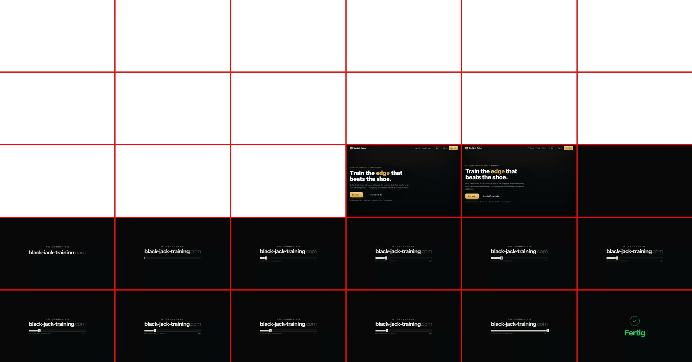
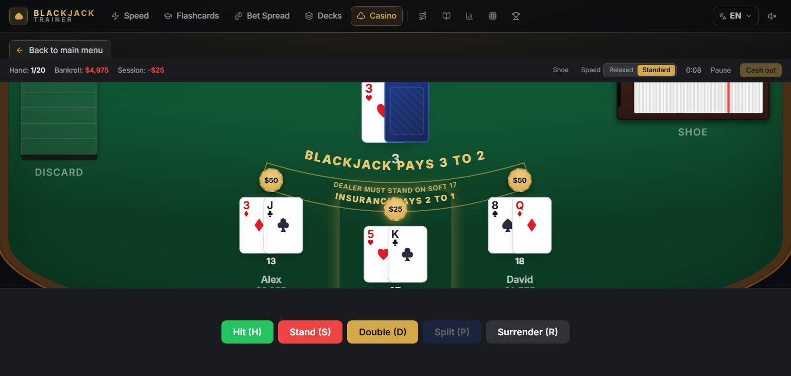
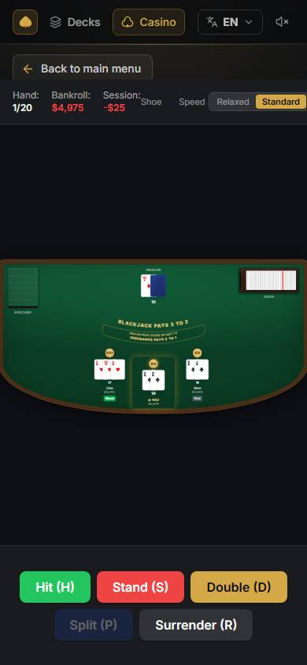

# Audit — 13 November 2026

Structure, design and logic of black-jack-training.com: first paint, navigation,
the casino table, the training modes and what the product tells the learner.
Nothing in this document is fixed yet except the two landing items under
*Already changed*; it is the list the fixes are worked from.

## How it was checked

- **Live site, measured.** Playwright against `https://black-jack-training.com`
  (build of 13 Nov 14:49, commit `6c02761`), German browser locale. The page
  logged its own state changes every 30 ms and the run was recorded as video.
  Server response time checked separately with `curl` (0.10 s, six runs).
- **Table, measured.** The local offline build, seeded with the demo learner,
  one hand played at six window sizes; clipping, scale and timings read from
  the DOM.
- **Code, read.** Three independent reviewers read the casino session, the
  loading/routing path and the training logic line by line. Their findings are
  marked by how far they were confirmed:

| Mark | Meaning |
|---|---|
| **M** | Measured in a browser for this audit |
| **V** | Reviewer finding, re-read at the cited lines for this audit and confirmed |
| **R** | Reviewer finding from reading the code, not re-verified here. Verify before fixing. |

Two measurement traps worth keeping: a Chrome tab in the background throttles
timers and `requestAnimationFrame`, so nothing about the loader can be timed
there; and `page.screenshot()` stalls for seconds on a page with a WebGL canvas,
so a polling screenshot loop slows the page it is measuring.

---

## A. First paint and loading — blocking

The visitor's report was: the loading screen has faults, and afterwards
everything "loads again". Both are true, and they are one defect.

**A1. The page is shown, taken away, and rebuilt. (M)**
The prerendered HTML paints first and is readable. Then `createRoot` in
`src/main.tsx:28` clears it, the welcome screen covers the viewport, and React
builds the same page again from nothing.

| Page (first visit in a tab) | Readable at | Covered from | Usable again at |
|---|---|---|---|
| `/learn/true-count` | 0.17 s | 0.40 s | **5.5 s** |
| `/de/strategy-chart` (phone) | 0.19 s | 0.45 s | **5.6 s** |
| `/` | first paint | +0.1 s | **+5.4 s** after first paint |
| `/` on a throttled phone (1.6 Mbit, 4× CPU) | 0.9 s | 4.5 s | **9.8 s** |

A reader from a search result gets 0.2 s of the article, then five seconds of
"WELCOME TO black-jack-training.com", then the article again at scroll position
0. The floor is in the constants (`intro-sequence.ts:67-68,92,104,124`): 4.58 s
plus exit and fade, even when everything was ready at 0 ms. Chrome reported an
LCP of 8.7 s for the landing page on a normal connection; Google's "good"
threshold is 2.5 s.

**A2. English first, then German. (M)**
At `/` a German browser gets the English prerendered page, an English loader
that changes to "WILLKOMMEN BEI" mid-animation, then the German page — at the
same URL. Only English is bundled; other languages load asynchronously
(`i18n/index.ts:79-99`). This also contradicts the rule in `CLAUDE.md` that a
URL sets the language and a browser language never changes what a URL shows:
`/` and `/de/` now serve the same German page to a German visitor, and a
crawler sees English at `/`.

**A3. A white screen before the dark page. (M)**
Until the stylesheet arrives the document is white (no inline background in
`index.html` or the prerendered files). On a dark site this is the first thing
every visitor sees.

**A4. The bar does not keep "one tempo" on the landing page. (M)**
With the three.js hero starting behind the loader, the bar sat at 17–20 % for
about 2 s and then jumped to 94 % in 270 ms (one main-thread task of 1.4 s).
On pages without the canvas it runs evenly. Measured under load; the size of
the stall will vary by machine, the cause will not.

**A5. Two loaders at once. (M)**
During the first load the welcome screen and the route spinner (`AppLoader`)
were in the DOM together for about 1.1 s. `chunksReady` only knows `/` and
`/app*` and ignores the language prefix (`App.tsx:120-126`), so on `/de`,
`/learn`, `/login`, `/account` the loader can finish and hand over to a
spinner. (V for the code path.)

**A6. Every reload: page → blank → spinner flash → page. (R)**
`React.lazy` commits its fallback once, the fallback is a blank full-height div
(`App.tsx:181`, `AppLoader.tsx:58`), the gold grid switches on at 220 ms and
React reveals at 300 ms — an 80 ms flash. The label reads "Loading your
training" on `/terms` too.

**A7. A paying user is "free" after every load. (V)**
`entitlement-store.ts:44-49` starts at `status: 'free'` with no cached value;
`loadEntitlement` runs last in a sequential sync of 5–7 round trips
(`cloud-sync.ts:185`). Until then a Pro customer sees the "Go Pro" crown, lock
icons, and the full paywall if they open a Pro mode. Hidden by the 4.6 s floor
on the first load, visible on every refresh.

**A8. Plan and dashboard render from zero sessions, then swap. (R)**
`stats-store.ts:82-83` starts empty and `TrainingPlan` / `DashboardHeader`
ignore `isLoading`: a stage-5 learner sees stage 1 and "Welcome", then the real
state. No skeleton, no reserved space.

**A9. After sign-out and sign-in, or on a new device, a returning learner is
new again. (R)** Placement, the welcome flag, the learner profile and read
stages are local only, wiped on sign-out and never restored
(`local-reset.ts:66-76`, `curriculum.ts:411-415`).

**A10. Smaller loader faults. (R)**
- The loader's clock is `requestAnimationFrame` only: a tab opened in the
  background sits at 00 % and starts its full 4.6 s when focused, although the
  app has long been ready (`IntroSequence.tsx:278-285`).
- The "Complete" tick is on screen 0–717 ms depending on when the app became
  ready; on slow loads it is never seen (`IntroSequence.tsx:306`).
- Loader text paints at rest for a frame, snaps below its mask, then rises
  (`IntroSequence.tsx:179-188`).
- `getSession` has no timeout: after 9 s the intro leaves and "Signing you in"
  stays indefinitely (`auth-store.ts:76`).
- Blank near-black screen after sign-in while the 175 kB trainer chunk loads
  (`LoginPage.tsx:24-26`).
- The scrollbar returns 0.5 s after the reveal; the page shifts sideways on
  Windows (no `scrollbar-gutter`).
- `/app`, `/login`, `/account` carry the landing page's title until mounted.

**A11. Weight. (M/R)** The landing page transfers 560 kB compressed in 23
requests; the entry chunk is 202 kB gz and nothing is `modulepreload`ed, so
the route chunks are only discovered after the entry has executed. The landing
pulls the whole casino table (45 kB gz) and three.js (132 kB gz). The server
compresses with gzip only.

### Direction

One change removes A1, A2, A5, A6 and most of A10: **hydrate the prerendered
pages instead of replacing them**, and keep the welcome sequence off public
pages altogether. Inside `/app`, replace the full-screen loader after the first
visit with **skeletons that have the final layout** (nav, plan card, stage
list), and cache the last known entitlement and stats so a returning customer
is drawn as what they are. Whether the welcome ceremony stays for the first
`/app` visit of a session is a product decision — see *Decisions*.

---

## B. Casino Session

### B1. The table does not fit ordinary windows — blocking (M)

The scene has a 420 px floor and is scaled from the box **width** alone
(`helpers.ts:84,128-131`, `CasinoTable.tsx:140-170`). Whenever the box is
shorter than the scaled scene, the centred overflow is cut on both sides and
the top half cannot be scrolled to.

| Window | Felt | Box | Cut off top / bottom |
|---|---|---|---|
| 1536 × 730 (a 15" laptop with Chrome's bars) | 576 px | 386–398 px | **93 / 97 px** |
| 390 × 844 phone | 175–200 px in a 523 px box | — | none, see B2 |

In the picture: the dealer's cards are cut, the "DEALER" label is gone, the
dealer total sits under "BLACKJACK PAYS 3 TO 2", the legend runs through the
chips, the player's own total and both name plates are below the fold, and
"Back to main menu" is half under the status bar. It fits only at 1080 px
viewport height — the size the demo recorder films at, which is why it was
never seen.

### B2. On a phone the table is unreadable and two controls are unreachable — blocking (M)

Scale 0.348: a card is **18 × 26 px** on screen, the felt uses a quarter of
the height and the rest is empty. The status bar is one non-wrapping row;
**Pause and Cash out are off-screen** with no way to reach them. The table
wrapper scrolls 373 px sideways. The felt's height changes while cards are
dealt (175 → 192 → 200 px).

### B3. The setup screen hides its own Start button (M)
On 1536 × 730 the Start button is at y = 1256, on a phone at y = 1825: more
than a full screen of settings before the one action most players want.

### B4. Things that can break a session — blocking

- **Enter twice at the count check deals a phantom hand. (V)** `submitCount`
  has no "already submitted" guard and each call schedules another
  `proceedAfterHand` 2 s later (`useGameLoop.ts:1420-1464`,
  `CasinoSessionGame.tsx:185-187`). The second callback wipes a hand that has
  already been bet and dealt; the bet stays deducted and the unseen cards are
  in the engine's running count, so every later count check is wrong for the
  player.
- **A 2-deck shoe can run out mid-round and freeze the table. (V for the
  mechanism, R for the rate)** The shoe is reshuffled only at the start of a
  round and `Shoe.deal()` throws when empty (`shoe.ts:74-78`,
  `session-engine.ts:195-221`). The reviewer's simulation of the real engine:
  2 decks / 85 % / 5 bots throws in 8.8 % of shoes, 4 bots 5.0 %; 6 and 8
  decks never. The table then sits in "dealing" or "playing" with dead
  controls; only Pause → Quit works, and that books the bet as lost.
- **Impossible table settings are accepted. (V)** Min bet 500 with max bet 50:
  `confirmBet` clamps below the minimum and returns — the table sits in
  betting forever (`useGameLoop.ts:919-921`). Bankroll 100 with min bet 500:
  the Deal button is enabled and does nothing (`BettingControls.tsx:143`).

### B5. Wrong numbers saved — should-fix

- **"Start fresh" records the session it promises to discard. (V)** The
  unmount cleanup flushes any session with a hand through `onSessionEnd`
  (`useGameLoop.ts:391-406`); the comment at `CasinoSession.tsx:229-234` says
  this path must not record. The summary screen appears instead of the setup.
- **Quit from the pause overlay mid-hand books unsettled money. (R)** Cash out
  in the HUD is disabled mid-hand for exactly this reason; "Quit" calls the
  same `endSession` at any time. A doubled $100 bet quit mid-hand is $200 low
  in analytics and the bankroll tracker.
- **The bet is graded against the count before a reshuffle. (R)** Past the cut
  card with TC +4, the correct minimum bet is marked wrong and a large one
  right, though the hand is dealt at TC 0 (`useGameLoop.ts:923-951`).
- **Insurance. (R)** Stake is `floor(bet/2)`, is not checked against the
  bankroll, and its result is not in the hand's profit label.
- **Auto-stand on 21 is stored as a graded, correct decision. (R)** Every 21
  inflates play accuracy and XP.
- **Pause time counts in the duration when quitting from the pause overlay. (R)**
- **Odd bets give fractions. (R)** $33 at 6:5 is 39.599999999999994; the
  bankroll can read "$4,987.5".

### B6. Keyboard and background — should-fix (V for the handler, R for the scenarios)

The window `keydown` handler (`CasinoSessionGame.tsx:156-196`):
- has no `e.repeat` check — holding Enter runs settlement → review → betting →
  deal at the minimum bet; holding H draws card after card;
- stays attached while the session is hidden behind another mode — Escape
  elsewhere un-pauses it, then h/s/d/Enter typed anywhere play hidden hands
  with real bankroll changes;
- is not suppressed under the "leave session?" dialog — Enter on "Stay" also
  deals a hand.

Pausing only freezes the clock: bots and dealer play on behind the overlay,
with sound (`useStepAnimation.ts:41-76`). A backgrounded session keeps the
casino ambience playing over every other mode.

### B7. Why it does not feel smooth (M for the first two, R for the rest)

- **A round takes 13 s with an instant Stand and two bots** at the default
  "Relaxed" speed; 7.2 s pass before the player may act. With five bots the
  reviewer's sum from the delay constants is about 50 s per hand. Nothing can
  be skipped, and several delays ignore the speed setting.
- **The seat jumps.** The player's seat moved 153 px in one frame when its
  first card landed (seat top 536 → 383 at 1536 × 730), and again at
  settlement: an empty seat reserves no card area and the row is
  bottom-aligned (`SeatView.tsx:33,119-149`).
- Cards already lying in a hand shift sideways on every hit; the overlap
  changes at the 5th and 7th card (`SeatView.tsx:34-39`).
- A split widens a seat up to 420 px; with six seats one split overflows the
  rim.
- "Next hand" removes all cards in one frame; there is no collect animation.
- The primary button is in three different places in three consecutive states
  (settlement, review, betting).
- The bet resets to $0 after every hand and the Deal button is disabled at $0
  while its label reads "Deal $25"; flat betting needs a chip click and Deal
  every hand. There is no rebet.
- Totals update 0.6 s before the card lands, so the number announces the card.
- Touch targets: Pause 16–18 px, speed buttons 19–21 px, Cash out 27 px,
  Deal 36 px, action buttons 40 px.

### B8. Table procedure and details (R)

- Cards are dealt from the seat under the discard tray towards the shoe. A
  real deal starts at first base, the seat next to the shoe.
- With 8 decks the shoe graphic is clipped and looks full until 88 cards are
  gone — the same graphic is the deck-estimation aid.
- A bot's bankroll drops by its double or split wager while an earlier bot is
  still "thinking" (the seats alias the engine's objects).
- "Show deviation hints" in the setup is read nowhere; the toggle does nothing.
- The review prints "Hit" / "Stand" in English in every language.
- The human's split hands show no per-hand result; inactive bot split hands
  are never dimmed.

### Checked and correct
Deal order and hole-card counting, dealer peek, insurance and surrender timing,
split rules including aces and DAS, bankroll arithmetic for every payout,
S17/H17 dealer play, reshuffle resetting the count, the double-fire guards on
Hit/Stand/Double/Split, timers cleared on unmount, zero-hand sessions not
recorded.

---

## C. Training logic and what the product claims

### C1. Pro sells a risk-of-ruin simulator that does not exist — blocking (V)
The paywall (`paywall.r8`), the landing page (`t6body`) and the Learn chapter
promise one. `BankrollSimulator.tsx` is a manual win/loss log;
`engine/simulation/bankroll-calculator.ts` is imported only by its own test.
Three achievements (`data_driven`, `risk_analyst`, `edge_hunter`) can never
unlock because `checkSimulationAchievements` has no caller. This is a paid
feature that is advertised and absent. If the calculator is wired up, its maths
needs a review first (base edge, share of hands at TC ≥ +1, SD from mean
instead of RMS bet — R).

### C2. Drill sessions are recorded cumulatively or twice — blocking (V for the mechanism)
`useSessionSave.ts:133-136`: `begin()` re-arms the save guard and never resets
the stats. Speed Drill: three rounds, back, one round, back, one round, back →
three "qualifying sessions" from five rounds, the stage completes and +250 XP
is paid. Flashcards, Bet Spread and Deck Estimation: finish a session, go back
to settings, start, leave before answering → the previous session is written
again with full XP.

### C3. The plan cannot be followed as written — should-fix
- "3 Speed Drills at 90 %": one drill run counts as one question and a session
  needs three, so three perfect drills on three days record nothing. (R)
- The Deviations stage opens Flashcards with "Basic Strategy" preselected
  (`DeviationTraining.tsx:66`, V) and those sessions do not count; the stage
  stays at 0/3 with no explanation. (R)
- The header says "0 of 5 stages" above a numbered list of 7; Analytics counts
  differently again and can name a next stage after the plan says "goal
  reached". (M for the first, R for the rest)
- The current stage has no action in the path list while later stages do. (M)
- For a free account placed at a Pro stage, "Start training" opens the
  paywall. (R)

### C4. Challenges and achievements — should-fix
- Three correct flashcards unlock six accuracy achievements, 570 XP and
  level 4: the drill side has no minimum sample
  (`achievement-engine.ts:443-451`, V).
- The daily challenge ignores the learner's stage: a stage-3 learner gets
  "Deviation Day" (M). The picker stores today's challenge with
  `{stage: null, isPro: false}` at import. (R)
- Uncompletable: `all_rounder` needs 7 modes and 5 are recordable;
  `mode_explorer` needs 3 and a free account has 2; `lightning_speed` (under
  500 ms average) is honestly unreachable. (R)
- The UTC day is used where the local day is required in three places; in CET
  a session at 00:30 on Monday counts as Sunday. (R)

### C5. Content that contradicts itself — should-fix
- **H17 chart, two cells. (V against the standard 4–8 deck H17 DAS LS chart)**
  A,6 v 2 is `D`, correct is Hit; 8,8 v A stays Split, correct with late
  surrender is Surrender (`basic-strategy-tables.ts:94,98-100`). Visible on
  the public `/strategy-chart` with the H17 toggle.
- **The deviation overlay contradicts its own cell** on 16 v 10, 15 v 10 and
  16 v 9: the cell says Surrender, the overlay "at TC 0 or higher → Stand
  (below: Hit)". With H17 it still shows S17 indices. (R)
- **Three different bet ramps are taught. (V)** Grading: 1-2-4-8-12-16 from
  TC ≤ 0 to ≥ +5. Learn chapter and FAQ: 1 unit at +1 or below, 2 at +2, 4 at
  +3, 8 at +4. The drill's own tip: (TC − 1) × unit. A learner who follows the
  Learn chapter is marked wrong at every count from +1 to +4.
- **True-count rounding has four conventions** (nearest 0.5, floor, exact
  match, ±0.5) and Learn says "round towards zero". (R)
- Learn says basic strategy hits 16 v 10; the basic flashcard expects
  Surrender. Insurance below +3 expects "Hit" as the answer. (R)
- Side panels describe another sub-mode: the Flashcards rail talks about true
  count and deviations while "Basic Strategy — no counting yet" is selected
  (M); Deck Estimation's summary is titled "Quick Fire Complete!" in normal
  mode (R).
- The paywall lists deviations as Pro-only; free Flashcards include them. (R)

### Checked and correct
The complete S17 table, the other five H17 cells, all Illustrious 18 and Fab 4
indices for S17, the Hi-Lo tags, Speed Drill counting and grading, Deck
Estimation tolerance, level thresholds and XP arithmetic.

---

## D. Structure and navigation — should-fix

- **No view has a URL. (M)** All 13 modes, the placement, the paywall and the
  open Learn topic live at `/app`. Browser Back leaves the app; a refresh
  returns to home and loses the hand or drill in progress; no mode can be
  linked from a video, a short or an email. A running Casino Session is
  destroyed by Back without a dialog. (R for the last)
- **The inner scroller keeps its position across modes. (R)** Scroll home to
  the tools, open Learn, and it opens scrolled down.
- **The home screen is two pages stacked. (M)** Plan plus the old dashboard,
  4 500 px. "The Hi-Lo count" appears four times and the same sentence twice;
  today's challenge twice; the awards count twice; two different "day streak"
  figures under one label.
- **Three ways home with three names** (logo, "Back to main menu", "Plan") and
  no visible "home" in the nav. (M)
- `ScrollToTop` also fires on Back; `/#pricing` lands at the top. (R)
- Sign-out navigates twice (login flash, Back from landing goes to `/login`). (R)

## E. Design consistency — should-fix

- **Five nav items are icons without labels** (Plan, Learn, Analytics,
  Strategy, Awards). (M)
- **No shared page header or width. (M)** Speed Drill: title in a card. Casino
  setup: centred gold H1. Analytics: left-aligned with an eyebrow. Flashcards:
  small title. The plan page stacks three container widths; welcome and
  placement sit at different left edges.
- **Touch targets under 44 px** across the app nav (30–38 px) and the table
  HUD (16–27 px). (M)
- Landing, desktop: pricing and FAQ use the left two thirds; the right third
  is empty. (M)
- The mode grid ends in an orphan row of two; "Bankroll Tracker" (real money)
  sits under "Training Modes". (M)
- English in the German interface: the app's H1, "max level reached",
  "-day streak", "% accuracy", "awards", action explanations on the chart,
  deviation names. (M for the H1, R for the rest)
- German terms for one thing: Lernkarten / Karteikarten / Karten;
  Bet Spread / Einsatzspreizung / Einsatz; Ziehen-Stehen-Splitten on buttons
  against Karte-Bleiben-Teilen on the chart; Schlitten / Schuh; Erfolge opens
  "Auszeichnungen"; "Stufe" for three different things. (R)

## F. Security and delivery

- **No security headers are live. (M)** `curl -sI` on `/` and `/app` returns
  no `Strict-Transport-Security`, no `Content-Security-Policy`, no
  `X-Frame-Options`, no `X-Content-Type-Options`, no `Referrer-Policy`. The
  Traefik middleware described in `docs/traefik-security-headers.yml` is not
  applied. On a site that starts Stripe checkouts this means the pages can be
  framed by another origin (clickjacking) and nothing pins HTTPS. Since
  8 Oct the repository's own `Caddyfile` serves the site, so the headers can
  now be set there, in the image, instead of on the server where a rebuild
  loses them silently.
- gzip only, no brotli or zstd (`encode gzip` in the `Caddyfile`). (M)
- Autodeploy: a push to `main` now deploys (switched on 13 Nov). The live
  check after a push is the `Last-Modified` header and the script hash in the
  HTML, not the repository.

---

## Already changed (local, not committed)

- `FeatureShowcase.tsx`: the feature grids are `grid-cols-1` below `lg`. At
  375 px the three Pro tiles were 340 px wide and ran 27 px past their frame.
- `FeatureVisuals.tsx`: the forced `min-h-[168px]` on the table picture is
  gone (it caused the above through the aspect ratio), and the picture no
  longer shows the table's own scrollbars.

Landing tests (36) pass; measured at 375 and 1440 px.

## Proposed order

| # | Package | Closes |
|---|---|---|
| 1 | First paint: hydrate public pages, no welcome screen on them, dark background inline, language from the URL, skeletons in `/app`, cached entitlement and stats | A1–A10 |
| 2 | Table fit: scale from width **and** height, a portrait layout for phones, a wrapping HUD, reserved seat space; then the session guards | B1–B4, B7 jumps |
| 3 | A URL per mode, Back and refresh that behave, scroll reset | D |
| 4 | Recorded truth: session double-saving, achievement minimum sample, plan thresholds, challenge eligibility, casino bookkeeping | C2–C4, B5, B6 |
| 5 | Security headers and compression in the `Caddyfile` | F |
| 6 | Content: H17 cells, overlay, one bet ramp, one rounding rule, side panels | C5 |
| 7 | One home screen, one page header, labelled nav, touch targets, terms | D, E |
| 8 | Table pace and polish: speeds, skip, rebet, collect animation, deal direction | B7, B8 |

Package 5 is small and independent; it can go out with package 1.

## Decisions (Darius)

1. **The welcome sequence.** Recommended: never on public pages; on `/app`
   only the first visit of a session, shortened, skeletons afterwards.
2. **Risk-of-ruin simulator (C1).** Remove the claim from the paywall, landing
   and Learn now, or build it. Recommended: remove now, build later with
   reviewed maths — a paid feature should not be advertised before it exists.
3. **The phone table.** Recommended: a portrait layout of its own (dealer on
   top, own seat large, bots reduced to a strip) instead of scaling the
   desktop scene to a third.
