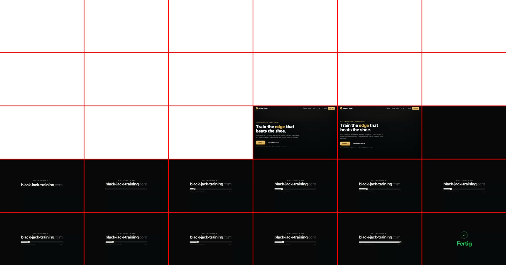
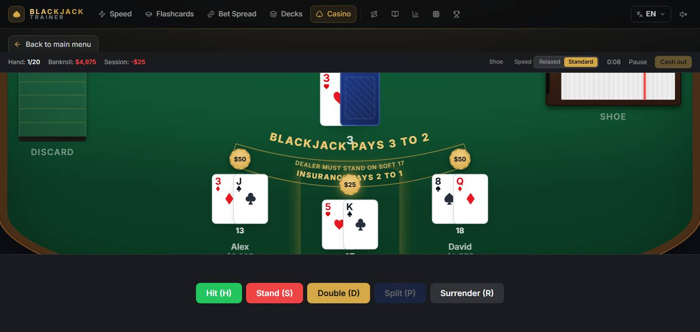
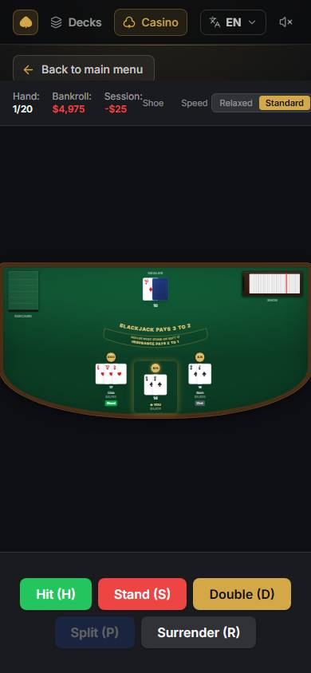

# Audit — 13 November 2026

Structure, design and logic of black-jack-training.com: first paint, navigation,
the casino table, the training modes and what the product tells the learner.
Nothing in this document is fixed yet except the two landing items under
*Already changed*; it is the list the fixes are worked from.

## How it was checked

- **Live site, measured.** Playwright against `https://black-jack-training.com`
  (build of 13 Nov 14:49, commit `6c02761`), German browser locale. The page
  logged its own state changes every 30 ms and the run was recorded as video.
  Server response time checked separately with `curl` (0.10 s, six runs).
- **Table, measured.** The local offline build, seeded with the demo learner,
  one hand played at six window sizes; clipping, scale and timings read from
  the DOM.
- **Code, read.** Three independent reviewers read the casino session, the
  loading/routing path and the training logic line by line. Their findings are
  marked by how far they were confirmed:

| Mark | Meaning |
|---|---|
| **M** | Measured in a browser for this audit |
| **V** | Reviewer finding, re-read at the cited lines for this audit and confirmed |
| **R** | Reviewer finding from reading the code, not re-verified here. Verify before fixing. |

Two measurement traps worth keeping: a Chrome tab in the background throttles
timers and `requestAnimationFrame`, so nothing about the loader can be timed
there; and `page.screenshot()` stalls for seconds on a page with a WebGL canvas,
so a polling screenshot loop slows the page it is measuring.

---

## A. First paint and loading — blocking

The visitor's report was: the loading screen has faults, and afterwards
everything "loads again". Both are true, and they are one defect.

**A1. The page is shown, taken away, and rebuilt. (M)**
The prerendered HTML paints first and is readable. Then `createRoot` in
`src/main.tsx:28` clears it, the welcome screen covers the viewport, and React
builds the same page again from nothing.

| Page (first visit in a tab) | Readable at | Covered from | Usable again at |
|---|---|---|---|
| `/learn/true-count` | 0.17 s | 0.40 s | **5.5 s** |
| `/de/strategy-chart` (phone) | 0.19 s | 0.45 s | **5.6 s** |
| `/` | first paint | +0.1 s | **+5.4 s** after first paint |
| `/` on a throttled phone (1.6 Mbit, 4× CPU) | 0.9 s | 4.5 s | **9.8 s** |

A reader from a search result gets 0.2 s of the article, then five seconds of
"WELCOME TO black-jack-training.com", then the article again at scroll position
0. The floor is in the constants (`intro-sequence.ts:67-68,92,104,124`): 4.58 s
plus exit and fade, even when everything was ready at 0 ms. Chrome reported an
LCP of 8.7 s for the landing page on a normal connection; Google's "good"
threshold is 2.5 s.

**A2. English first, then German. (M)**
At `/` a German browser gets the English prerendered page, an English loader
that changes to "WILLKOMMEN BEI" mid-animation, then the German page — at the
same URL. Only English is bundled; other languages load asynchronously
(`i18n/index.ts:79-99`). This also contradicts the rule in `CLAUDE.md` that a
URL sets the language and a browser language never changes what a URL shows:
`/` and `/de/` now serve the same German page to a German visitor, and a
crawler sees English at `/`.

**A3. A white screen before the dark page. (M)**
Until the stylesheet arrives the document is white (no inline background in
`index.html` or the prerendered files). On a dark site this is the first thing
every visitor sees.

**A4. The bar does not keep "one tempo" on the landing page. (M)**
With the three.js hero starting behind the loader, the bar sat at 17–20 % for
about 2 s and then jumped to 94 % in 270 ms (one main-thread task of 1.4 s).
On pages without the canvas it runs evenly. Measured under load; the size of
the stall will vary by machine, the cause will not.

**A5. Two loaders at once. (M)**
During the first load the welcome screen and the route spinner (`AppLoader`)
were in the DOM together for about 1.1 s. `chunksReady` only knows `/` and
`/app*` and ignores the language prefix (`App.tsx:120-126`), so on `/de`,
`/learn`, `/login`, `/account` the loader can finish and hand over to a
spinner. (V for the code path.)

**A6. Every reload: page → blank → spinner flash → page. (R)**
`React.lazy` commits its fallback once, the fallback is a blank full-height div
(`App.tsx:181`, `AppLoader.tsx:58`), the gold grid switches on at 220 ms and
React reveals at 300 ms — an 80 ms flash. The label reads "Loading your
training" on `/terms` too.

**A7. A paying user is "free" after every load. (V)**
`entitlement-store.ts:44-49` starts at `status: 'free'` with no cached value;
`loadEntitlement` runs last in a sequential sync of 5–7 round trips
(`cloud-sync.ts:185`). Until then a Pro customer sees the "Go Pro" crown, lock
icons, and the full paywall if they open a Pro mode. Hidden by the 4.6 s floor
on the first load, visible on every refresh.

**A8. Plan and dashboard render from zero sessions, then swap. (R)**
`stats-store.ts:82-83` starts empty and `TrainingPlan` / `DashboardHeader`
ignore `isLoading`: a stage-5 learner sees stage 1 and "Welcome", then the real
state. No skeleton, no reserved space.

**A9. After sign-out and sign-in, or on a new device, a returning learner is
new again. (R)** Placement, the welcome flag, the learner profile and read
stages are local only, wiped on sign-out and never restored
(`local-reset.ts:66-76`, `curriculum.ts:411-415`).

**A10. Smaller loader faults. (R)**
- The loader's clock is `requestAnimationFrame` only: a tab opened in the
  background sits at 00 % and starts its full 4.6 s when focused, although the
  app has long been ready (`IntroSequence.tsx:278-285`).
- The "Complete" tick is on screen 0–717 ms depending on when the app became
  ready; on slow loads it is never seen (`IntroSequence.tsx:306`).
- Loader text paints at rest for a frame, snaps below its mask, then rises
  (`IntroSequence.tsx:179-188`).
- `getSession` has no timeout: after 9 s the intro leaves and "Signing you in"
  stays indefinitely (`auth-store.ts:76`).
- Blank near-black screen after sign-in while the 175 kB trainer chunk loads
  (`LoginPage.tsx:24-26`).
- The scrollbar returns 0.5 s after the reveal; the page shifts sideways on
  Windows (no `scrollbar-gutter`).
- `/app`, `/login`, `/account` carry the landing page's title until mounted.

**A11. Weight. (M/R)** The landing page transfers 560 kB compressed in 23
requests; the entry chunk is 202 kB gz and nothing is `modulepreload`ed, so
the route chunks are only discovered after the entry has executed. The landing
pulls the whole casino table (45 kB gz) and three.js (132 kB gz). The server
compresses with gzip only.

### Direction

One change removes A1, A2, A5, A6 and most of A10: **hydrate the prerendered
pages instead of replacing them**, and keep the welcome sequence off public
pages altogether. Inside `/app`, replace the full-screen loader after the first
visit with **skeletons that have the final layout** (nav, plan card, stage
list), and cache the last known entitlement and stats so a returning customer
is drawn as what they are. Whether the welcome ceremony stays for the first
`/app` visit of a session is a product decision — see *Decisions*.

---

## B. Casino Session

### B1. The table does not fit ordinary windows — blocking (M)

The scene has a 420 px floor and is scaled from the box **width** alone
(`helpers.ts:84,128-131`, `CasinoTable.tsx:140-170`). Whenever the box is
shorter than the scaled scene, the centred overflow is cut on both sides and
the top half cannot be scrolled to.

| Window | Felt | Box | Cut off top / bottom |
|---|---|---|---|
| 1536 × 730 (a 15" laptop with Chrome's bars) | 576 px | 386–398 px | **93 / 97 px** |
| 390 × 844 phone | 175–200 px in a 523 px box | — | none, see B2 |

In the picture: the dealer's cards are cut, the "DEALER" label is gone, the
dealer total sits under "BLACKJACK PAYS 3 TO 2", the legend runs through the
chips, the player's own total and both name plates are below the fold, and
"Back to main menu" is half under the status bar. It fits only at 1080 px
viewport height — the size the demo recorder films at, which is why it was
never seen.

### B2. On a phone the table is unreadable and two controls are unreachable — blocking (M)

Scale 0.348: a card is **18 × 26 px** on screen, the felt uses a quarter of
the height and the rest is empty. The status bar is one non-wrapping row;
**Pause and Cash out are off-screen** with no way to reach them. The table
wrapper scrolls 373 px sideways. The felt's height changes while cards are
dealt (175 → 192 → 200 px).

### B3. The setup screen hides its own Start button (M)
On 1536 × 730 the Start button is at y = 1256, on a phone at y = 1825: more
than a full screen of settings before the one action most players want.

### B4. Things that can break a session — blocking

- **Enter twice at the count check deals a phantom hand. (V)** `submitCount`
  has no "already submitted" guard and each call schedules another
  `proceedAfterHand` 2 s later (`useGameLoop.ts:1420-1464`,
  `CasinoSessionGame.tsx:185-187`). The second callback wipes a hand that has
  already been bet and dealt; the bet stays deducted and the unseen cards are
  in the engine's running count, so every later count check is wrong for the
  player.
- **A 2-deck shoe can run out mid-round and freeze the table. (V for the
  mechanism, R for the rate)** The shoe is reshuffled only at the start of a
  round and `Shoe.deal()` throws when empty (`shoe.ts:74-78`,
  `session-engine.ts:195-221`). The reviewer's simulation of the real engine:
  2 decks / 85 % / 5 bots throws in 8.8 % of shoes, 4 bots 5.0 %; 6 and 8
  decks never. The table then sits in "dealing" or "playing" with dead
  controls; only Pause → Quit works, and that books the bet as lost.
- **Impossible table settings are accepted. (V)** Min bet 500 with max bet 50:
  `confirmBet` clamps below the minimum and returns — the table sits in
  betting forever (`useGameLoop.ts:919-921`). Bankroll 100 with min bet 500:
  the Deal button is enabled and does nothing (`BettingControls.tsx:143`).

### B5. Wrong numbers saved — should-fix

- **"Start fresh" records the session it promises to discard. (V)** The
  unmount cleanup flushes any session with a hand through `onSessionEnd`
  (`useGameLoop.ts:391-406`); the comment at `CasinoSession.tsx:229-234` says
  this path must not record. The summary screen appears instead of the setup.
- **Quit from the pause overlay mid-hand books unsettled money. (R)** Cash out
  in the HUD is disabled mid-hand for exactly this reason; "Quit" calls the
  same `endSession` at any time. A doubled $100 bet quit mid-hand is $200 low
  in analytics and the bankroll tracker.
- **The bet is graded against the count before a reshuffle. (R)** Past the cut
  card with TC +4, the correct minimum bet is marked wrong and a large one
  right, though the hand is dealt at TC 0 (`useGameLoop.ts:923-951`).
- **Insurance. (R)** Stake is `floor(bet/2)`, is not checked against the
  bankroll, and its result is not in the hand's profit label.
- **Auto-stand on 21 is stored as a graded, correct decision. (R)** Every 21
  inflates play accuracy and XP.
- **Pause time counts in the duration when quitting from the pause overlay. (R)**
- **Odd bets give fractions. (R)** $33 at 6:5 is 39.599999999999994; the
  bankroll can read "$4,987.5".

### B6. Keyboard and background — should-fix (V for the handler, R for the scenarios)

The window `keydown` handler (`CasinoSessionGame.tsx:156-196`):
- has no `e.repeat` check — holding Enter runs settlement → review → betting →
  deal at the minimum bet; holding H draws card after card;
- stays attached while the session is hidden behind another mode — Escape
  elsewhere un-pauses it, then h/s/d/Enter typed anywhere play hidden hands
  with real bankroll changes;
- is not suppressed under the "leave session?" dialog — Enter on "Stay" also
  deals a hand.

Pausing only freezes the clock: bots and dealer play on behind the overlay,
with sound (`useStepAnimation.ts:41-76`). A backgrounded session keeps the
casino ambience playing over every other mode.

### B7. Why it does not feel smooth (M for the first two, R for the rest)

- **A round takes 13 s with an instant Stand and two bots** at the default
  "Relaxed" speed; 7.2 s pass before the player may act. With five bots the
  reviewer's sum from the delay constants is about 50 s per hand. Nothing can
  be skipped, and several delays ignore the speed setting.
- **The seat jumps.** The player's seat moved 153 px in one frame when its
  first card landed (seat top 536 → 383 at 1536 × 730), and again at
  settlement: an empty seat reserves no card area and the row is
  bottom-aligned (`SeatView.tsx:33,119-149`).
- Cards already lying in a hand shift sideways on every hit; the overlap
  changes at the 5th and 7th card (`SeatView.tsx:34-39`).
- A split widens a seat up to 420 px; with six seats one split overflows the
  rim.
- "Next hand" removes all cards in one frame; there is no collect animation.
- The primary button is in three different places in three consecutive states
  (settlement, review, betting).
- The bet resets to $0 after every hand and the Deal button is disabled at $0
  while its label reads "Deal $25"; flat betting needs a chip click and Deal
  every hand. There is no rebet.
- Totals update 0.6 s before the card lands, so the number announces the card.
- Touch targets: Pause 16–18 px, speed buttons 19–21 px, Cash out 27 px,
  Deal 36 px, action buttons 40 px.

### B8. Table procedure and details (R)

- Cards are dealt from the seat under the discard tray towards the shoe. A
  real deal starts at first base, the seat next to the shoe.
- With 8 decks the shoe graphic is clipped and looks full until 88 cards are
  gone — the same graphic is the deck-estimation aid.
- A bot's bankroll drops by its double or split wager while an earlier bot is
  still "thinking" (the seats alias the engine's objects).
- "Show deviation hints" in the setup is read nowhere; the toggle does nothing.
- The review prints "Hit" / "Stand" in English in every language.
- The human's split hands show no per-hand result; inactive bot split hands
  are never dimmed.

### Checked and correct
Deal order and hole-card counting, dealer peek, insurance and surrender timing,
split rules including aces and DAS, bankroll arithmetic for every payout,
S17/H17 dealer play, reshuffle resetting the count, the double-fire guards on
Hit/Stand/Double/Split, timers cleared on unmount, zero-hand sessions not
recorded.

---

## C. Training logic and what the product claims

### C1. Pro sells a risk-of-ruin simulator that does not exist — blocking (V)
The paywall (`paywall.r8`), the landing page (`t6body`) and the Learn chapter
promise one. `BankrollSimulator.tsx` is a manual win/loss log;
`engine/simulation/bankroll-calculator.ts` is imported only by its own test.
Three achievements (`data_driven`, `risk_analyst`, `edge_hunter`) can never
unlock because `checkSimulationAchievements` has no caller. This is a paid
feature that is advertised and absent. If the calculator is wired up, its maths
needs a review first (base edge, share of hands at TC ≥ +1, SD from mean
instead of RMS bet — R).

### C2. Drill sessions are recorded cumulatively or twice — blocking (V for the mechanism)
`useSessionSave.ts:133-136`: `begin()` re-arms the save guard and never resets
the stats. Speed Drill: three rounds, back, one round, back, one round, back →
three "qualifying sessions" from five rounds, the stage completes and +250 XP
is paid. Flashcards, Bet Spread and Deck Estimation: finish a session, go back
to settings, start, leave before answering → the previous session is written
again with full XP.

### C3. The plan cannot be followed as written — should-fix
- "3 Speed Drills at 90 %": one drill run counts as one question and a session
  needs three, so three perfect drills on three days record nothing. (R)
- The Deviations stage opens Flashcards with "Basic Strategy" preselected
  (`DeviationTraining.tsx:66`, V) and those sessions do not count; the stage
  stays at 0/3 with no explanation. (R)
- The header says "0 of 5 stages" above a numbered list of 7; Analytics counts
  differently again and can name a next stage after the plan says "goal
  reached". (M for the first, R for the rest)
- The current stage has no action in the path list while later stages do. (M)
- For a free account placed at a Pro stage, "Start training" opens the
  paywall. (R)

### C4. Challenges and achievements — should-fix
- Three correct flashcards unlock six accuracy achievements, 570 XP and
  level 4: the drill side has no minimum sample
  (`achievement-engine.ts:443-451`, V).
- The daily challenge ignores the learner's stage: a stage-3 learner gets
  "Deviation Day" (M). The picker stores today's challenge with
  `{stage: null, isPro: false}` at import. (R)
- Uncompletable: `all_rounder` needs 7 modes and 5 are recordable;
  `mode_explorer` needs 3 and a free account has 2; `lightning_speed` (under
  500 ms average) is honestly unreachable. (R)
- The UTC day is used where the local day is required in three places; in CET
  a session at 00:30 on Monday counts as Sunday. (R)

### C5. Content that contradicts itself — should-fix
- **H17 chart, two cells. (V against the standard 4–8 deck H17 DAS LS chart)**
  A,6 v 2 is `D`, correct is Hit; 8,8 v A stays Split, correct with late
  surrender is Surrender (`basic-strategy-tables.ts:94,98-100`). Visible on
  the public `/strategy-chart` with the H17 toggle.
- **The deviation overlay contradicts its own cell** on 16 v 10, 15 v 10 and
  16 v 9: the cell says Surrender, the overlay "at TC 0 or higher → Stand
  (below: Hit)". With H17 it still shows S17 indices. (R)
- **Three different bet ramps are taught. (V)** Grading: 1-2-4-8-12-16 from
  TC ≤ 0 to ≥ +5. Learn chapter and FAQ: 1 unit at +1 or below, 2 at +2, 4 at
  +3, 8 at +4. The drill's own tip: (TC − 1) × unit. A learner who follows the
  Learn chapter is marked wrong at every count from +1 to +4.
- **True-count rounding has four conventions** (nearest 0.5, floor, exact
  match, ±0.5) and Learn says "round towards zero". (R)
- Learn says basic strategy hits 16 v 10; the basic flashcard expects
  Surrender. Insurance below +3 expects "Hit" as the answer. (R)
- Side panels describe another sub-mode: the Flashcards rail talks about true
  count and deviations while "Basic Strategy — no counting yet" is selected
  (M); Deck Estimation's summary is titled "Quick Fire Complete!" in normal
  mode (R).
- The paywall lists deviations as Pro-only; free Flashcards include them. (R)

### Checked and correct
The complete S17 table, the other five H17 cells, all Illustrious 18 and Fab 4
indices for S17, the Hi-Lo tags, Speed Drill counting and grading, Deck
Estimation tolerance, level thresholds and XP arithmetic.

---

## D. Structure and navigation — should-fix

- **No view has a URL. (M)** All 13 modes, the placement, the paywall and the
  open Learn topic live at `/app`. Browser Back leaves the app; a refresh
  returns to home and loses the hand or drill in progress; no mode can be
  linked from a video, a short or an email. A running Casino Session is
  destroyed by Back without a dialog. (R for the last)
- **The inner scroller keeps its position across modes. (R)** Scroll home to
  the tools, open Learn, and it opens scrolled down.
- **The home screen is two pages stacked. (M)** Plan plus the old dashboard,
  4 500 px. "The Hi-Lo count" appears four times and the same sentence twice;
  today's challenge twice; the awards count twice; two different "day streak"
  figures under one label.
- **Three ways home with three names** (logo, "Back to main menu", "Plan") and
  no visible "home" in the nav. (M)
- `ScrollToTop` also fires on Back; `/#pricing` lands at the top. (R)
- Sign-out navigates twice (login flash, Back from landing goes to `/login`). (R)

## E. Design consistency — should-fix

- **Five nav items are icons without labels** (Plan, Learn, Analytics,
  Strategy, Awards). (M)
- **No shared page header or width. (M)** Speed Drill: title in a card. Casino
  setup: centred gold H1. Analytics: left-aligned with an eyebrow. Flashcards:
  small title. The plan page stacks three container widths; welcome and
  placement sit at different left edges.
- **Touch targets under 44 px** across the app nav (30–38 px) and the table
  HUD (16–27 px). (M)
- Landing, desktop: pricing and FAQ use the left two thirds; the right third
  is empty. (M)
- The mode grid ends in an orphan row of two; "Bankroll Tracker" (real money)
  sits under "Training Modes". (M)
- English in the German interface: the app's H1, "max level reached",
  "-day streak", "% accuracy", "awards", action explanations on the chart,
  deviation names. (M for the H1, R for the rest)
- German terms for one thing: Lernkarten / Karteikarten / Karten;
  Bet Spread / Einsatzspreizung / Einsatz; Ziehen-Stehen-Splitten on buttons
  against Karte-Bleiben-Teilen on the chart; Schlitten / Schuh; Erfolge opens
  "Auszeichnungen"; "Stufe" for three different things. (R)

## F. Security and delivery

- **No security headers are live. (M)** `curl -sI` on `/` and `/app` returns
  no `Strict-Transport-Security`, no `Content-Security-Policy`, no
  `X-Frame-Options`, no `X-Content-Type-Options`, no `Referrer-Policy`. The
  Traefik middleware described in `docs/traefik-security-headers.yml` is not
  applied. On a site that starts Stripe checkouts this means the pages can be
  framed by another origin (clickjacking) and nothing pins HTTPS. Since
  8 Oct the repository's own `Caddyfile` serves the site, so the headers can
  now be set there, in the image, instead of on the server where a rebuild
  loses them silently.
- gzip only, no brotli or zstd (`encode gzip` in the `Caddyfile`). (M)
- Autodeploy: a push to `main` now deploys (switched on 13 Nov). The live
  check after a push is the `Last-Modified` header and the script hash in the
  HTML, not the repository.

---

## Already changed (local, not committed)

- `FeatureShowcase.tsx`: the feature grids are `grid-cols-1` below `lg`. At
  375 px the three Pro tiles were 340 px wide and ran 27 px past their frame.
- `FeatureVisuals.tsx`: the forced `min-h-[168px]` on the table picture is
  gone (it caused the above through the aspect ratio), and the picture no
  longer shows the table's own scrollbars.

Landing tests (36) pass; measured at 375 and 1440 px.

## Status

| Item | State |
|---|---|
| A1, A2, A3, A5, A6, A7 | **fixed** — `1d8c5fa`, live 13 Nov. Measured live: German landing visible at 0.73 s, sign-in at 0.34 s, a chapter is never covered |
| F (headers) | **fixed** — `1d8c5fa`; full CSP still report-only, no violations on landing, chapter, chart, sign-in |
| A4, A8, A9, A10 | open |
| B1 (table cut off) | **fixed** — 15 Nov. `fitTable` caps the scale by height; at 1536×730 nothing is clipped (was 93/97 px), the felt is 1205×430 |
| B2 (phone) | **improved, not finished** — the scene is drawn narrower before it is scaled (cards 30×43 px, were 18×26), the HUD wraps so Pause and Cash out are reachable, nothing scrolls sideways. A portrait layout of its own is still the real answer |
| B4 (double Enter, empty shoe, impossible limits) | **fixed** — 15 Nov, each with a test that fails without the guard |
| B6 (held key) | **fixed** for auto-repeat; the handler still listens while the session is hidden |
| B7 (seat jump on the first card) | **fixed** — an empty hand reserves its height. The 18–32 px jump at settlement is open |
| B7 (pace) | **improved** — 15 Nov. A third speed, "Fast" (0.5): a round with two bots and an instant Stand takes 6.9 s instead of 13.2 s, 3.8 s before the player may act instead of 7.2 s. The two pauses that ignored the speed setting follow it now |
| B7 (bet reset to $0 every hand) | **fixed** — the last bet stays on the spot; the next hand is one click |
| B7 (seat jumps at settlement) | **fixed** — the result line has its height from the deal on; measured, the seat's position does not change between bet and settlement |
| B7 (rest: cards shift sideways on a hit, no collect animation, primary button in three places, totals ahead of the card) | open |
| B3, B5, B8, rest of B6 | open |
| D (no URL per view) | **fixed** — 15 Nov. Every mode is `/app/<slug>` (`hooks/use-mode-url.ts`); Back, Forward, refresh and links work, checked in a browser. Back from a hand in progress asks first; a refresh with a live session asks the browser's question. Each screen opens at the top |
| D (rest: home screen stacked, three ways home, sign-out twice, hash links) | open |
| C2 (drills recorded cumulatively or twice) | **fixed** — 15 Nov. A recorded session's figures are cleared; the Speed Drill's totals end with its session; the clock runs from the first shoe of a sitting |
| C4 (awards from three answers) | **fixed** — 15 Nov. An accuracy counts towards a best, an award or a stage from 10 answers (Speed Drill: 3 shoes), `services/accuracy-sample.ts` |
| C3 (Deviations stage opens on Basic Strategy) | **fixed** — Flashcards opens on the level the plan is at |
| C3 (rest: "3 Speed Drills" needs three shoes per sitting, stage counts differ) | open — lowering the minimum would let a one-shoe sitting farm session XP; needs a decision on XP per session first |
| B5 ("Start fresh" recorded the session) | **fixed** — 15 Nov |
| B5 (quit mid-hand) | **fixed** — 15 Nov. A session that ends with a hand open (Quit from the pause overlay, navigating away, closing) hands that hand's bets back; the tests fail without the refund |
| B5 (bet graded before a reshuffle) | **fixed** — the bet is graded at the count it will be played at: a fresh shoe's once the cut card is out |
| B5 (insurance) | **fixed** — exactly half the bet (was rounded down), never more than the bankroll holds, and included in the hand's figure |
| B5 (21 graded as a decision, pause counted as play, payouts with floating-point dust) | **fixed** — a stand on 21 is not recorded as a decision; a session quit from the pause ends when the pause began; payouts and the display are to the cent |
| C5 (H17 chart) | **fixed** — 15 Nov. Soft 17 v 2 is a hit under both rule sets; 8,8 v A is surrender-else-split (new code `Rp`). Two tests had pinned the wrong double |
| C5 (overlay contradicts its cell) | **fixed** for the three surrender cells: the index is labelled "without late surrender". With H17 selected the overlay still shows S17 indices — open |
| C5 (Flashcards rail, Deck Estimation title) | **fixed** — the rail describes the selected level; the summary names the mode that was played |
| C5 (three bet ramps) | **fixed** — 15 Nov, one ramp in `engine/betting/bet-ramp.ts`; see below |
| C5 (four rounding rules, Learn text on 16 v 10 and 13 v 2) | open |
| E (five nav items were bare icons) | **fixed** — 15 Nov. Plan, Learn, Analytics, Strategy and Awards are a labelled menu ("More"); on a phone the menu lists all ten screens and the sideways-scrolling strip is gone. Rows are 44px |
| D (home screen names everything twice) | **partly fixed** — the plan's inline challenge bar is not shown on the home screen (the full cards follow below), and the dashboard's "Start: <stage>" button is gone (the plan's own button does that); it remains as "Continue <mode>" |
| E (English in the German interface) | **partly fixed** — streak, accuracy, awards and "max level reached" in the dashboard are translated. Chart explanations, deviation names and the app's H1 are open |
| E (page headers, container widths, landing layout, touch targets in the right-hand cluster, terminology) | open |
| C1 (risk-of-ruin simulator) | **fixed** — 15 Nov, by removing the claim (decision 2). The paywall row is "Bankroll Tracker", the landing card describes the session log, and the Learn chapter on bet spreads no longer points at a tool that shows the risk "as a number" — in all seven languages. The three awards that needed a simulation run (Data Driven, Risk Analyst, Edge Hunter) could never unlock and are gone with their code; the catalogue is 99. Left as it is: the unused `engine/simulation/bankroll-calculator.ts`, the two simulation counters in the profile sync (cloud columns), and the words "risk-of-ruin estimates" in the Terms' education-only disclaimer |
| C4 (challenges) | open |

Two flaky tests were found and fixed on the way: `session-end.test.tsx` stacked
four cards in six and left the rest to chance, and the prerender suite's import
had reached 9.6 s against a 10 s limit.

### The bet ramp — decided 15 Nov 2026

There were three: the Learn chapter and FAQ (one unit to +1, then 2, 4, 8, up
to 16), the grading in the drill and at the table (two units already at +1,
then 4, 8, 12, 16), and the drill's tip ((true count − 1) × unit). Darius
decided for the taught ramp. It now lives once, in
`src/engine/betting/bet-ramp.ts`, and both the drill and the table read it
from there: 1 unit to +1, 2 at +2, 4 at +3, 8 at +4, 16 from +5. The drill has
five levels instead of six, its bottom level includes +1 on purpose, and the
tip states the ramp in all seven languages.

Still open in the drill's rail: "A true count is shown" is only true for one
of the three question types, and "Closer to optimal = more points" describes a
grading the drill does not have — it is exact match.

## Proposed order

| # | Package | Closes |
|---|---|---|
| 1 | First paint: hydrate public pages, no welcome screen on them, dark background inline, language from the URL, skeletons in `/app`, cached entitlement and stats | A1–A10 |
| 2 | Table fit: scale from width **and** height, a portrait layout for phones, a wrapping HUD, reserved seat space; then the session guards | B1–B4, B7 jumps |
| 3 | A URL per mode, Back and refresh that behave, scroll reset | D |
| 4 | Recorded truth: session double-saving, achievement minimum sample, plan thresholds, challenge eligibility, casino bookkeeping | C2–C4, B5, B6 |
| 5 | Security headers and compression in the `Caddyfile` | F |
| 6 | Content: H17 cells, overlay, one bet ramp, one rounding rule, side panels | C5 |
| 7 | One home screen, one page header, labelled nav, touch targets, terms | D, E |
| 8 | Table pace and polish: speeds, skip, rebet, collect animation, deal direction | B7, B8 |

Package 5 is small and independent; it can go out with package 1.

## Decisions (Darius)

1. **The welcome sequence.** Recommended: never on public pages; on `/app`
   only the first visit of a session, shortened, skeletons afterwards.
2. **Risk-of-ruin simulator (C1).** Remove the claim from the paywall, landing
   and Learn now, or build it. Recommended: remove now, build later with
   reviewed maths — a paid feature should not be advertised before it exists.
3. **The phone table.** Recommended: a portrait layout of its own (dealer on
   top, own seat large, bots reduced to a strip) instead of scaling the
   desktop scene to a third.

## 15 Nov 2026 — second pass: the look, and the casino table

Darius after the deploy of `1e52c2e`: the site looks grainy, "as if it had noise
on it"; the casino session stutters, looks poor and should feel like an online
casino table; the cards are bad; a bot's split shakes the screen.

### What was measured

- **The grain is banding.** `.app-canvas` drew three stacked gradients on
  `#070809` (gold bloom at 10 %, a white fall at 5 %, a vignette), fixed to the
  viewport; the landing hero added a scrim, a 190px inset shadow and fog. Between
  the ground and the brightest point there are about a dozen 8-bit steps spread
  over a whole screen: visible as rings in a lossless screenshot at 125 % scale,
  and as shimmer on a panel that dithers. Not a texture anyone added — a
  consequence of "barely there" light on near-black.
- **The hero was smudges.** The WebGL scene showed cards and chips small,
  blurred and dim by design. Three.js was loaded for it and for nothing else.
- **The table resized on every phase.** The control area was `min-h-[9.5rem]`
  (171px at the 18px root) and the bet panel needs 183px, so the felt was
  scaled 0.805 → 0.828 → back on every deal.
- **A split moves the row.** Traced per frame on `/dev/split`: the bot's seat
  grows 140 → 151 → 185 → 234 → 268px and its left edge moves 570 → 506px, in
  four steps, because seats are self-sizing blocks in a centred flex row. Every
  neighbour moves with it. `layout="position"` runs inside a CSS-scaled scene.
- **Cards were drawn four ways**, each a white box with a font's suit glyph.
  On the table a card is 46 × 66px on a 1536px screen.

### The principle (decided 15 Nov)

**Flat black ground, real objects.** The ground is one colour and carries no
light of its own. Depth and colour come from things: a surface one step lighter
with a hairline border, green felt, white cards, chips in their denomination
colours, gold for the one thing to press. No glow, fog, vignette or gradient
larger than a button. Show the product instead of decorating around it.

### Done in this pass

| Item | Status |
|---|---|
| Ground | flat; glows and vignettes removed from the app canvas, the settings backdrop, the sign-in page, the home screen and three landing sections |
| Landing hero | a dealt hand on felt, counted card by card (`HeroHand`); Three.js removed from the bundle |
| Cards | one vector drawing (`components/cards/CardFace.tsx`): suits as paths, a compact layout for table sizes, pips and framed courts for large cards, a red back |
| Table size | constant through a session (control area 10.25rem) |
| Seats | equal slots across the felt, one width for the session; a hand is laid out from the left edge of a fixed box, so a hit or a split moves nothing that is already down. Traced on `/dev/split`: the seat stays at one position and width through a re-split (before: four moves, 64px) |
| Risk of ruin | gone everywhere: Terms sentence, a code comment, and `engine/simulation/` deleted (nothing imported it) |

### Open — the casino table as an online-casino table

In this order; each is its own package.

1. ~~Bigger cards.~~ **Done 15 Nov.** A card is 76 × 106 table units
   (`TABLE_CARD` in helpers.ts, was 56 × 80 by CSS class) and the app's
   navigation is hidden at the live table (the session bar has the sound
   switch now). On a 1536 × 730 laptop a card went from 46 × 66px to
   60 × 84px; the felt from 433 to 497px high. The dealer's hand is laid out
   from a fixed box like the seats'.
2. ~~Chips.~~ **Done 15 Nov.** One drawn chip (`Chip.tsx`), coloured by value
   (white 1, red 5, blue 10, green 25, black 100, purple 500, gold 1,000); the
   bet on a seat is a stack cut into denominations; a lost bet is taken up the
   table, a won one is paid with a second stack, a push stays. The bet buttons
   use the same chip. Not yet: the chip flying from the button to the spot.
3. ~~Results.~~ **Done 15 Nov** (without sound, which is item 4). A plate
   across the cards: BLACKJACK the moment two cards make 21 (one sweep of
   light), BUST the moment the card is down (the hand greys), WIN at
   settlement beside the payout stack. A split hand's 21 is not a blackjack.
   Seen in the browser by playing hands until each had occurred. The scene's
   floor is 624 so a split seat no longer pushes the legend into the dealer's
   total; a card on a 1536 × 730 laptop is 59 × 82px.
4. ~~Sound.~~ **Done 15 Nov.** Recordings from Kenney's "Casino Audio" (CC0,
   licence in `public/sounds/table`) for a dealt card, the dealer's reveal, a
   chip placed, a payout, a bet taken and a shuffle: sixteen mono MP3s, 133 kB
   together, fetched with the first sound and not with the page. Several takes
   of each, never the same twice in a row, each play shifted a few percent in
   pitch and level (`services/table-samples.ts`); the synthesised cue is the
   fallback. A settled hand sounds like chips, not like the trainer's
   "correct"/"wrong" tones. Darius asked for the choice to be made for him;
   it was made **by measurement, not by ear** (short, onset within 40ms,
   matched level and brightness). Verified at the table: 16 files fetched, 50
   sample plays in four hands. No win or blackjack jingle — the pack has none.
5. **Several hands.** The player may open more than one seat (an engine change:
   one human, several seats, each with its own bet, insurance and count check).
6. **Bots with a temperament.** Today every bot plays perfect basic strategy
   and bets flat. Give each a profile — by the book, timid (stands on 16 v 10,
   never doubles soft), gambler (hits 12–13 against a low card, chases with
   bigger bets) — so the table behaves like people.
7. **Phone.** A portrait layout of its own. Portrait works (a card is 44px
   wide at 390 × 844); **landscape does not**: the session bar and the control
   area leave the felt 131px, a scale of 0.19. Not new — it was worse with the
   navigation above it — but it is unusable.

### XP — proposal

Problem: XP is paid per recorded session, so the cheapest way up is many short
sessions, and three correct flashcards unlock six awards and level 4 (C4).

- Pay for **correct decisions**, not for finishing: a small amount per graded
  answer, capped per day and mode, so one long session and three short ones are
  worth the same.
- **A minimum sample** before accuracy counts for anything (20 answers; the
  rule already exists for the plan as `provesAccuracy`).
- **Mastery pays most**: finishing a curriculum stage and beating a personal
  best are the large awards; daily and weekly challenges stay, tied to the
  learner's stage.
- Nobody loses a level: totals only go up, requirements are not raised.

## 16 Nov 2026 — after the first look at the new table

Darius, with `8a62005` live: the chips, the plates and the split are right. Six
things are not.

| Reported | What it was | Status |
|---|---|---|
| The chip paid for a win has no number on it | the payout stack was a copy of the bet without a label | **fixed** — its own stack with its own amount: a blackjack on $75 shows $112.50 |
| A bot that doubles puts no second chip out, and is then paid as if it had | display only: the engine doubles `hand.bet` and settles on it; the seat showed `bot.currentBet`, the opening bet, for the whole round | **fixed** — the spot shows every bet the bot has out, once it has acted |
| The shuffle sound is bad | the pack's one recording | **removed** — a new shoe is announced and silent |
| The shoe is shuffled after the bet | `dealNewRound` shuffled; the player bet on a count that was already gone | **fixed** — `reshuffleAfterRound()` runs when the player leaves the finished round, before betting opens. Seen in the browser: notice up, betting panel up, no card on the table |
| A betting window, as at an online table | — | **added** — 30 seconds (`BET_SECONDS`), Enter deals at once, at zero the table deals with what is placed (or the last bet, or the minimum). Stops while paused, behind the end-of-session question and during the shuffle notice. Deals one round on its own, never a second |
| Several hands for one player | — | open — see below |

### Several hands — what it takes

The engine has one human with one seat (`humanHands` is that seat's split
hands). Several hands means several *seats* for one player: each with its own
bet, its own insurance decision, its own splits and its own result, played
left to right before the bots to their left. That touches the engine's seat
model, the settlement, the session record (per-hand records keyed by hand
number), the count check and the bet grading — the money path, end to end. It
is its own package, with its own tests, not an addition to this one.

### Several hands — built 16 Nov 2026

The player may take one, two or three hands a round ("Hands 1 2 3" in the bet
panel). Each is a box of its own on the felt.

- **Engine.** `dealNewRound(humanBoxes)` deals round the player's boxes in turn
  at the player's seat, both passes; `DealResult.humanBoxCards` carries every
  hand. `setHumanBoxes` also counts towards how many cards a round may need.
- **Game loop.** `humanHands` already held the hands of a split; it now holds
  every hand of every box, with `humanHandInfo` beside it (`box`, `split`).
  What a hand may do follows the hand, not how many there are: a second box
  can be a blackjack, be surrendered and be doubled like a first hand; a hand
  out of a split cannot. The split limit counts within a box. A box dealt a
  blackjack is not played. Surrender gives up one hand, not the round.
- **Money.** The bet is per hand and the same on each (v1); it is deducted and
  held open once per hand, so a session quit mid-round hands all of it back.
  Insurance is one decision for the round, at half of everything bet. Each box
  shows its own result and payout.
- **The record.** Still one `PlayerHandRecord` per round: `playerBet` is the bet
  per hand, `profit` the round's total. The bet is graded per hand against the
  ramp, as before.

Checked in the browser: twelve rounds with three hands, six splits and six
doubles — the bankroll moved by exactly the sum of the boxes' results every
round, and a blackjack on the second box paid 3 to 2.

Not in v1: a different bet per hand; opening a box by clicking it on the felt;
an insurance decision per hand.

### The landing hero — corrected 16 Nov 2026

The counted hand on a felt panel (`HeroHand`) was rejected on sight: "mega
billig". What had been asked for was narrower than what was done — remove the
grain and draw real cards. The animation of cards coming out of the dark was
liked and should never have been removed.

Now: the WebGL scene is back (`HeroCanvas`, three.js again) on the flat black
ground. Its cards are the product's own card painted to a canvas — the suit
paths and pip positions of `CardFace`, shared through `cards/card-suits.ts` —
with corner indices, real pips and framed courts. The out-of-focus copies are
gone (they were the smudges), the black 100 chips are purple 500s (a black
chip on black is a smudge too), and the only layers over the canvas are the
ground's own colour: a patch behind the headline, and on a phone one flat
tone over all of it so no card runs through the text.

### Bots with a temperament — built 16 Nov 2026

Every bot played perfect basic strategy and bet the same amount each round.
Each now has a profile (`BOT_PROFILES`, `temperedAction`, `nextBotBet` in
`engine/casino-session/bot-player.ts`), dealt out so a small table holds
different kinds:

| Kind | Plays | Bets |
|---|---|---|
| by the book (two of five) | basic strategy | its own amount, flat |
| timid | never doubles, splits only aces and eights, often stands on 15/16 against a high card, never hits soft 18 | the table minimum |
| gambler | doubles any 8–11, hits 12/13 against a low card, sometimes splits tens | doubles after a winning round, up to three times |
| never bust | stands on every hard 12 or more | its own amount, flat |

A bot is wrong in character and right the rest of the time; none ever doubles
or splits where the table does not allow it. The temperament is not shown on
the table — people at a table do not wear labels.

### Several hands, second step — built 16 Nov 2026

The three things left out of v1.

- **A bet of its own on each hand.** `boxBets` holds one bet per box
  (`useGameLoop`). Chips and the typed amount go on every hand until one is
  picked; then on that hand alone, and the line above the chips says which
  ("All hands" / "Hand 2"). A double or a split costs the bet of the hand it
  is made on. Deal names every bet when they differ ("Deal — $25 + $50 +
  $75"), and each hand keeps its bet for the next round. The round is graded
  on the bet per hand, and counts as a correct bet only if every hand's is.
- **Hands on the felt.** While betting, each of the player's hands is a
  target on the table: a click picks it, a second click lets go, × takes it
  away, and + beside the last hand opens another (up to three, as far as the
  bankroll reaches). The 1–2–3 selector stays, for the keyboard and for a
  phone, where the felt is small.
- **Insurance hand by hand.** The question is asked once per hand, the hand
  in question lit and the others dimmed; each insures half of its own bet and
  carries its own result. The decision is recorded once per answer; the hand
  record counts it correct only if every answer was.

Measured in a browser, 40 rounds with $25 / $50 / $75 on three hands, six
splits, eleven doubles, three insurance rounds (yes / no / yes): the bankroll
moved by exactly the sum of the three results every round.

Found on the way: `bot bets flat amount every hand` in
`session-engine.test.ts` failed one run in five since the bots got
temperaments — whenever the one bot drawn was the timid one, which bets the
minimum. It now checks every kind.

Still open here: a hand insured against a dealer blackjack reads "Loss $0";
on a phone three hands leave cards 34px wide.

### The table on a phone — built 16 Nov 2026

Measured first, at 390 × 844 and 844 × 390:

| | before | now |
|---|---|---|
| upright, 2 bots + 1 hand: the player's card | 44px | 51px |
| upright, 5 bots + 3 hands: the player's card | 25px | 51px (bots 32px) |
| upright: felt while betting / while playing | 449px / 560px — it resized every round | 551px / 551px |
| upright: status bar | three rows | two |
| sideways: the felt | 268 × 115px | 531 × 314px |

- **Upright: two rows of seats** (`isStackedBox`, `fitStackedTable`,
  `stackedBotZoom` in `helpers.ts`). The other players sit in a row of their
  own, drawn smaller; the player's hands are below them at full size. The
  scene is fitted on both axes and drawn to fill its box. The tray and the
  shoe are drawn smaller so the dealer's hand has the rail, and the felt's
  bottom arc is shallower so it does not cut into the player's hands.
- **Sideways: the controls stand beside the felt** (`short:` variant in
  `index.css`, a wide box under 520px of height). Under it they left the
  felt a strip.
- **The bet panel fits one height** (`compact`): no prompt and no range, six
  smaller chips in one row, the clock in the row. The controls area is a
  little taller on a phone so betting and playing are the same size.
- **Status bar:** the shoe bar, the dealing speed and the volume leave it on
  a phone; the speed switch is in the pause panel there. Pause, Cash out,
  sound and back are larger touch targets.

Known limits: with five bots a bot's name is about 6px on a phone (its cards
and chips are what is counted, and those read); sideways with five bots and
three hands the seats are 119 units wide and long hands run into their
neighbours; a bot hand of four or more cards can overlap the next bot upright.
The app's own config screen still needs scrolling to reach Start on a phone.

### XP — the first half of the proposal, built 16 Nov 2026

**What a session pays** (`sessionXPEarned`, `sessionXP` in
`services/level-system.ts`):

| | before | now |
|---|---|---|
| finishing any session | 25 XP (casino 60) | nothing |
| a correct answer | nothing | 2 XP (casino decision 3, Speed Drill run 12) |
| accuracy | +10 / 20 / 40 / 70 flat, whatever the size | ×1.25 from 85 %, ×1.5 from 95 %, from 10 answers (Speed Drill 3) |
| 50 / 100 questions | +15 / +35 | paid by the answers themselves |
| casino profit | +8 per $500 | nothing — it is luck |
| per day and mode | no limit | 150 XP |

Three correct flashcards were 95 XP and are 6. Twenty flashcards, all right,
were 95 and are 60 — in one session or in four. The day's limit is worked out
from the day's own sessions, not kept in a counter, so signing out does not
reset it and every device agrees. When the limit takes part of a session the
toast says so; when it takes all of it the toast says that instead of "+0 XP".

Nobody loses anything: totals are untouched, no level asks for more.

The sample is the existing one (`minAnswersFor`: 10 answers, Speed Drill 3),
not the 20 of the proposal — one rule for awards, plan and XP.

**Not built:** an award for beating a personal best; challenges tied to the
learner's stage (C4). Stage rewards (150 XP and up) were already the largest
training award and now equal or exceed a full day's limit in one mode.

### The cards are the standard deck — 16 Nov 2026

Rejected a second time: the product's own J, Q and K were a letter in a
frame. "Picture Card — da ist kein Picture drauf." A court card is its
picture, and nobody draws a better king than the one everybody knows.

- The 52 faces are Byron Knoll's public-domain deck (via
  `notpeter/Vector-Playing-Cards`), rendered to 360 × 504 WebP in
  `public/cards` with the licence note beside them: 956 KB in all, 5 KB for a
  number card and about 42 KB for a court card, each fetched only when shown.
- `CardFace` `full` is that image, for every rank. `compact` (every card on a
  table) keeps its large index, and a J, Q or K shows the figure where a
  number card shows its suit.
- The landing hero paints the same images onto its drifting cards.

Still drawing cards their own way: `landing/FeatureVisuals.tsx` and
`learn/TeachingVisuals.tsx`.

### Next — the table's seats (Darius, 16 Nov 2026, after the first look at several hands)

Rejected: the + beside the player's hand and the outline it opens ("komplett
off"), the seats not lying on one curve, the player's chip higher than a
waiting bot's. Asked for, with online casinos as the reference:

- a table of **six seats**, always all six on the felt, laid out evenly along
  the curve of the table, every betting spot on the same arc;
- a **switch in the session setup** for playing several hands; with it on,
  every free seat shows a + and the player may open as many hands as there
  are free seats (four bots: two hands);
- a **30-second clock for a decision**; when it runs out the hand stands.

### Six seats on the curve — built 17 Nov 2026

The brief above, built.

- **A hand is a seat.** The engine keeps the seats of the player's hands
  (`setHumanBoxSeats`, `getFreeSeats`); `dealNewRound` deals each hand when the
  deal reaches its seat. Play goes round the table the same way: before one of
  the player's hands gets the turn, the bots sitting before it play
  (`botStepsBefore`, `enterHand` in `useGameLoop`), so a bot between two of the
  player's hands plays between them. The player may hold up to six hands —
  what the bots leave free.
- **One seat for everybody** (`SeatShell`): cards, the betting circle, one
  line for what is happening and then the result, the name — fixed heights,
  the same for the player, a bot and an empty seat. That is what puts every
  betting circle on one curve; before, the player's seat and a bot's were two
  different stacks of parts aligned at the bottom, and the player's chip stood
  higher. The chips are in front of the player and the cards between the
  circle and the dealer, as on a table.
- **All six seats are on the felt** along `SEAT_ARC`. A free seat is a circle;
  with "Play several hands" on in the setup it carries a + and one click takes
  it. The player's own circles are the buttons while betting: gold when the
  chips go on that hand alone, a small × to give the hand up. The rectangle
  around a hand and the + beside it are gone.
- **The decision clock**: 30 seconds per decision (`DECISION_SECONDS`), shown
  over the action buttons, red for the last five; at zero the hand stands.
  It starts over for every decision and does not run while paused.
- A bot's status ("Stand", "Bust") and its result share one line now: the
  result replaces the status at settlement instead of standing under it.

Measured in a browser: 30 rounds, three bots, the player on seats 1, 4 and 6
with bots between, $25 / $50 / $75, six splits, five doubles — the bankroll
moved by exactly the sum of the three results every round. Phone, four bots
and two hands: four rounds, the same.

On an upright phone the bots keep their own smaller row (there is no width
for six places); a free seat is offered as one + beside the player's hands.

## The plan remembers, and lasts — 17 Nov 2026

Darius, after the table deploy: signing out and in again asked "where are you
starting from?" a second time; the home screen after sign-in was untidy; the
plan was "cheap and illogical" — finishable in ten minutes, the same for
someone with an hour a day and someone with ten minutes a week.

**The question that came back.** Placement, goal, pace, the read stages and
the "seen" flags lived in eight `bjt_*` keys and nowhere else. Sign-out wipes
those keys (a security boundary, unchanged) and nothing restored them. They
now travel as one value in `profiles.settings.plan` (`services/plan-state.ts`):
seen-flags merge by OR, the reading list by union, the answers by "whoever
answered last, as a unit" — and a side with no answer never beats one that has
one. Two further defects sat behind the first:

- The plan read its answers once, on mount, before the sign-in merge landed.
  It now reads them live (`usePlanState`) and shows an outline while the
  account is on its way (`plan-loading`) instead of judging an empty device.
- A push before the first merge on a page load would have overwritten
  `settings` — one jsonb value — with an empty device's copy. A push before
  the merge now *is* the merge (`hasMerged` in `profiles-sync.ts`).

**A stage takes days.** Every drill stage has `minDays`: its qualifying
sessions must fall on that many different calendar days (8 sessions on 4 days
for basic strategy, 10 on 5 for the count, …). 50 good sessions on 26 days for
the whole road, where it was 18 sessions in one sitting. Stages already paid
stay finished (`claimed`), so raising the bar takes nothing away. XP per stage
is unchanged.

**Time is asked once, in days and minutes.** After the level question:
training days a week (1–7) and minutes on such a day (10/20/30/60). Stored
with the account, editable in the plan. The bar of a stage does not depend on
it — less time means the same road takes longer, and the plan says how long
("about 11 weeks at this pace").

**A training day is a list.** `services/daily-plan.ts` cuts the day to the
minutes: a warm-up on the earlier stage not touched for longest (a different
one comes round as they are practised), the stage on turn, and for Pro a
Casino Session once counting is in place. A free account whose stage is
behind the paywall gets a day built from what is open, and is told so. Runs
of one drill are one row with a pip per run.

**The home screen** is one column of one width: level and numbers, three
sentences for a new account ("how this works", dismissed once per account),
the plan with today's session, the road as a line of seven points, then
challenges and modes. Gone from it: the product title, the "start here" card,
the "continue <last mode>" button that disagreed with the plan, and the seven
stage cards (they are on the plan's own page).

## The table, after two reviews — 17 Nov 2026

A design review (6.5/10) and a logic review of `2e372a0`, both by agents.
Fixed: the seat arc now follows the rim (`SEAT_ARC` 70/20/0 — circle-to-rim
82/86/85 where it was 56/82/85); whose turn it is glows on the betting circle,
not as a rectangle round the seat; one ring strength for every circle; no
"Wait" badge before a card is dealt; a stand made by the clock is played but
not graded; the shuffle estimate counts the hands a player may still open; the
phone's hand stepper grows and shrinks from the seats held instead of
rebuilding them. Open, named by the review and not done: payout chips sit to
one side of the circle, the betting clock hangs left of the Deal button,
"Hand 1/2" names both boxes and split hands, bot and player result lines use
different type, upright phone shows two rows and not six seats, insurance
stakes are booked one after another.

## The open list, worked through — 18 Nov 2026

Darius, with the split layout live: "passt sehr, sehr gut" — and then the
whole remaining list, top to bottom.

**Table**
- Insurance on several hands is staked from the bankroll as it stands when
  the decision is made (`settleInsurances`), not hand after hand with the
  first hand's win paying the second hand's stake.
- An insured hand lost to a dealer blackjack reads "Insured $0", not "Loss $0".
- A paid bet and its payout stand as a pair centred on the circle; the payout
  is three chips at most and carries no figure (the result line has it).
- The betting clock is balanced about the Deal button: bar left, time right.
- One result line and one total size for every seat (`resultClass`).
- The standard card faces on the table, and split hands that stay in their
  seat (`splitLayout`: two per row, a second row from the third hand, scaled
  as one piece) — `e9dbcf0`.

**Phone**
- Bot names in the small row are drawn back up to a readable size; the
  bankroll gives its line to the name.
- Sideways, the six chips are two rows of three.
- The row of hand numbers is gone: hands are opened on the felt everywhere.
- The setup's Start button stays in reach at the bottom of a phone.
- Not changed: upright, the bots keep a row of their own. Six seats on one
  arc at 390 px would be six unreadable hands.

**Plan and XP**
- A stage's reading leaves the day's list once it has been opened.
- A ten-minute day at the table stage gets a ten-minute sit, not fifteen.
- A new personal best pays 50 XP (`personalBestXP`): proven sessions only,
  three of them as history, a whole point better, once a day per mode, and
  outside the day's limit.
- Two days in three the daily and weekly challenge belong to the stage on
  turn (`selectChallenge`); the third stays open.

**Tidying**
- Removed: `StartHere`, `ProductTitle`, the pip tables nothing draws from.
- One card back: the lesson figures use the table's.
- Not changed, and why: the small rank-and-suit tokens on the landing page
  and in the lessons stay as they are. At 24–48 px a printed card is a smudge;
  those are diagram tokens, not cards on a table.
- Not changed: page headers. The drills share one layout (rail, card, rail)
  and the pages share one title style; the difference between the two is the
  difference between a drill and a page.

**Content-Security-Policy, enforced**
The full policy ran report-only from 13 Nov. Checked with a
`securitypolicyviolation` listener — the browser console tools do not show
these reports, and the first check, read from the console, proved nothing —
signed out on nine public pages and signed in on every app screen including a
dealt hand: no report. The Caddyfile now sends it as
`Content-Security-Policy` with `upgrade-insecure-requests`; the way back is
written beside it. **After the deploy: sign out and in once (captcha) and
start a checkout up to Stripe's page.** Those two were not exercised under the
enforced policy.

## May we count your visit? — 18 Nov 2026

The visit statistics store a random id in the browser. That is not needed to
show a page, so for visitors from the EU it wants a yes first; the question
had been open since the analytics were built. Darius: accept and decline, the
way every site does it, and never again for someone who has answered.

- `CookieBanner`: a bar along the bottom with two equal buttons and a link to
  the privacy policy, in seven languages. Not in the prerendered HTML.
- `analyticsAllowed()` has its fifth `return false`: no answer is a no.
  Nothing is sent and no id is stored until "Accept"; "Decline" removes an id
  stored earlier. The page a visitor is on when they accept is counted from
  that moment.
- The answer is a device preference (`bjt_cookie_consent`): it survives the
  sign-out wipe, so it is asked once per device.
- "Cookie settings" in both public footers asks again.
- Not asked where nothing would be counted: Global Privacy Control, Do Not
  Track, a build without a database.
- The privacy policy says all of this, dated 18 Nov 2026.

Consequence, stated to Darius before building: visitors who decline or ignore
the bar are no longer in the numbers.

## A second pass over the whole app — 18 Nov 2026

Almost every screen had changed since the audit of 13 Nov, so two agents went
through the app again: one on a desktop in German, one on a phone (390 × 844,
360 × 640, 844 × 390). 25 and 20 findings; what was fixed, by area.

**Wrong, not just untidy**
- The hand review called a hand "correct" when its *first* decision was — a
  hard 18 hit into a bust read "Play: correct". It reads every decision now
  (`hand-review.test.tsx`).
- A click on a strategy-chart cell seemed to do nothing: its explanation
  appeared 800 px further down. It is scrolled into view.
- With the review after each hand on, "Next hand" needed two presses under one
  label; the first press is "Continue".
- At 360 × 640 the table flipped between its two layouts inside every round:
  the box left for it is almost square, and five pixels of controls tipped
  it. The layout follows how the phone is held (`isStackedBox(box, screen)`).
- The awards page scrolled sideways on a phone (an invisible 438 px tooltip in
  the layout), and a medal's description was hover-only. A tap opens it.

**The table**
- From 1024 px the chips and the Deal button share a row; the controls area is
  7.75rem there and the 45 px go to the felt (cards about 9 % larger at
  1536 × 730).
- The BLACKJACK plate sits on the lower edge of the cards and no longer covers
  the ace. The printed legend fades under a two-row split at the middle seats.
- All 52 card faces are fetched when the drill or the table opens
  (`preloadCardImages`); the Speed Drill shows the printed card, with the drawn
  one underneath in case an image is late.

**German, and one word per thing**
- English left in the German interface is gone from analytics, the chart, the
  plan and the lessons; numbers use the locale's format.
- Lernkarten, Bet Spread, Auswertung, Auszeichnungen, Schlitten — one term
  each across landing, nav and pages; the same alignment in fr, it, pt, tr
  where nav and page title had differed.

**The plan**
- The header counts the whole road to the goal ("5 of 7"), as the line of
  points draws it; analytics uses the same rule.
- A stage finished ahead of the one on turn gets an outlined tick.
- Runs of a drill are dots, not two bars that read as a pause sign.

**Phone**
- Cookie bar: a short text on phones. Count inputs: 16 px and a number pad.
  Action buttons drop "(H)" on touch. The welcome button stays in reach.
- Strategy chart: the Hand column is sticky, with a fade where more follows.
- Public header and footer no longer overflow at 360 px; the nav menu stays
  inside the screen; "Next" in Deck Estimation is above the fold.
- The controls named as under 28 px are 40 px tall.

**Left as it is, deliberately**
- Drills in phone landscape still need scrolling: a rebuild of four screens.
- The setup's volume slider and toggles are under 40 px.
- On a phone the cookie bar still lies over the casino setup's Start button
  until it is answered.
- The translations in es, fr, it, pt, tr were aligned mechanically and have
  not been read by a native speaker.
- Reported and not done: the weak-hand insight's gold highlight does not
  apply in languages that write "80 %"; the accuracy tile and the Deck
  Estimation summary hardcode the percent sign.

## What the second pass left, done — 18 Nov 2026

- **Cookie bar on a phone:** the bar publishes its height (`--cookie-bar`) and
  the buttons pinned to the bottom (table setup, welcome) stand on top of it.
- **Percent signs follow the language:** the accuracy tile (`percentMarked`),
  the Deck Estimation summary, and the gold highlight of the weakest hand,
  which never applied where the language writes "80 %".
- **The table's sound switch** names the thing and states its state, like the
  nav's. **Switches and sliders** are 40 px tall to the finger.
- **Phone, 360 × 640:** the controls area gives 16 px back to the felt. With
  five bots the bots' cards stay small there; more would need the session bar
  rebuilt.
- **Drills in phone landscape** fit without scrolling during a run: two
  columns under the `short` variant, the back bar hidden while a run is on
  (`data-drill-run`). Measured at 844 × 390, 740 × 360 and 667 × 375, in
  English and German. Setup screens still scroll there.
- **A failed checkout leaves a trace.** `logFailure` now also reports an
  allow-listed set of places (checkout, billing portal, export, reset,
  profile) through `report_client_failure`, with e-mails, tokens and keys
  scrubbed, queued in `sessionStorage` when the network is down. The admin
  page lists the last 50. Migration `20261118120000_client_failures.sql`,
  36 SQL tests in PGlite. **Has to be pushed by the owner.**
- **Retention is scheduled** in the same migration, where `pg_cron` exists:
  visit statistics 13 months, failure reports 90 days, weekly. Not testable
  locally — check `cron.job` after the push.

Not started, and the owner's call: reminders on training days (needs a mail
service), the legal texts in the other languages (needs a decision on machine
translation with "the English version prevails").
